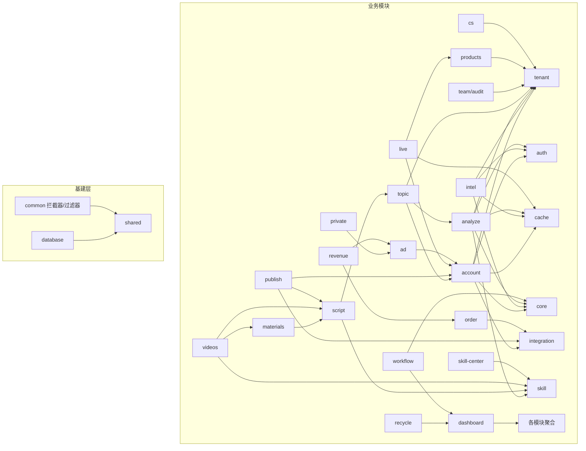

# 智享全链运营系统 · 架构与模块边界

> 版本：v0.2.0 · 日期：2026-08-25 · 依据：`zhixiang-ops-backend/src/app.module.ts` + 各模块实体/控制器实际代码

## 1. 总体形态

- **后端**：NestJS 11 + TypeORM + MySQL(MariaDB) + Redis（ioredis 全局单例）+ JWT + pino/飞书告警。端口 `3100`，全局前缀 `/api`。
- **前端**：Vue3 + Vite5 + TypeScript + Element Plus + Pinia + Vue Router（动态 import 全路由懒加载）。
- **双模式**：`OPS_INTEGRATION_MODE`（standalone 默认 / connected 接入管理系统），适配层隔离差异。

## 2. 分层与依赖方向（关键约束）

```
业务模块 modules/*（A~Z、AA、ecommerce、system-* …）
   │  只允许依赖：shared / common / cache / tenant / auth / core / integration（契约接口）
   ▼
基建层 shared / common / cache(Redis) / tenant / auth / database / core
   ▼
框架与外部：@nestjs/*、TypeORM、ioredis、bcryptjs、jsonwebtoken、mysql2 …
```

- **模块依赖规则（v0.2.1 修订，按实际代码校准）**：
  1. 全部模块可依赖基建层：`shared / common / cache / tenant / auth / core / integration / skill`。
  2. `N 模块（审计 AuditService）` 为横切能力，任何业务模块均可 import（实测 18 个模块引用）。
  3. 业务模块间 import 必须**单向无环**，方向对齐内容主链：
     `intel(C) → analyze(D) → topic(E) → script(F) → material(G) → video(H) → publish(I) → recycle(J)`；
     下游可依赖上游，禁止反向依赖与循环依赖。
  4. **聚合/编排模块**（`m` 决策看板、`workflow`、`ops-automation`、`video-automation`、`aa` 客服）
     允许聚合多个业务域（消费其 Service/只读查询）；普通业务模块不应直接注入他域 Service，
     跨域数据协作优先走聚合层或 API。
  5. 跨域实体 `TypeOrmModule.forFeature` 注册：现状为聚合与联动模块按需注册他域实体做**只读聚合**
     （如 `m` 注册 12 域、`publish` 注册 `AccountEntity/ScriptEntity/VideoEntity`、`w` 注册 `AdMetricEntity`）。
     约定：这些注册只允许读（find/count/createQueryBuilder 聚合），**写他域实体必须经该域的 Service**，
     保证业务规则与审计单点收口。
- **集成边界**：`src/integration/` 是对管理系统/外部平台的唯一出口，业务模块只依赖 `adapters.ts` 定义的接口（ProductAdapter / OrderAdapter / CommissionAdapter / AuthAdapter），不感知 standalone/connected 实现差异。
- **能力网关**：`src/skill/`（SkillGateway + 多 Provider）是 AI 能力的唯一出口；LLM 具体端点配置在 `src/modules/llm/`（能力网关管理平面）。

## 3. 已注册模块清单（来源 app.module.ts）

| 域 | 模块 | 用途 |
|---|---|---|
| 基建 | HealthModule | 健康检查 `/api/ops/health` |
| 基建 | DatabaseModule / RedisModule / TenantModule / AuthModule | 连池、缓存、租户上下文、鉴权 |
| 基建 | SkillModule / IntegrationModule | AI 能力网关 / 管理系统适配层 |
| B | AccountModule | 账号矩阵（OAuth、分组、健康分） |
| C | IntelModule | 情报采集（竞品/评论/任务/热点） |
| D | AnalyzeModule | 人性分析与洞察引擎 |
| E | TopicModule | 选题引擎 |
| F | ScriptModule | 脚本工坊 |
| I | PublishModule | 发布管理 |
| L | WorkflowModule | 工作流编排 |
| J | RecycleModule | 数据监控与回收（复盘） |
| N | NModule | 团队权限（角色/审计） |
| T | TModule | 选品中心 |
| R | RModule | 商品内容 |
| K | KModule | 直播运营 |
| S | SModule | 投流 |
| U | UModule | 私域粉丝 |
| W | WModule | 收益与对账 |
| Y | YModule | 订单物流 |
| AA | AAModule | 智能客服 |
| M | MModule | 决策仪表盘 |
| G | GModule | 素材中心 |
| H | HModule | 智能成片 |
| V | VModule | 达人/商单 |
| X | XModule | 内容出海 |
| P | ComplianceModule | 合规预检 |
| Z | SkillCenterModule | 技能中心 |
| 增强 | OpsAutomationModule / VideoAutomationModule | 自动链/视频自动化策略 |
| 增强 | DashboardModule / AiChatModule | 聚合看板 / AI 对话框后端 |
| 增强 | LlmModule / EmployeeModule | 能力网关管理 / 员工 |
| 系统 | SystemModule + DemoModule / SystemConfigModule / EcommerceModule | 系统初始化 / 配置中心 / 电商货架管线 |

> 规划 27 域（3 基座 + 24 业务）已全部落地；`app.module.ts` 逐模块注册，无循环依赖。

## 4. 依赖图（Mermaid）



## 5. 横切约定（全部业务模块必须遵守）

1. **响应信封**：`ResponseInterceptor` 自动包裹 `{code,msg,data,traceId}`；业务异常 `throw new AppError('错误码')`。
2. **traceId**：`TenantMiddleware` 生成，贯穿 interceptor/filter/logger，业务代码禁止自行造 traceId。
3. **多租户**：实体继承 `BaseEntity`（tenantId + 软删）；读取用 `TenantContext.getTenantId()` / `requireTenantId()`；请求头 `tenantId`/`x-tenant-id`，登录态优先取 JWT。
4. **分页**：`PaginationQueryDto` + `buildPage(...)`，返回 `{list,total,page,pageSize}`。
5. **鉴权**：受保护接口 `@UseGuards(JwtAuthGuard)`（全局默认），登录用户 `@CurrentUser()`；角色 `@Roles(...)`（RolesGuard）。
6. **命名**：表 `ops_*`，枚举/错误码集中在 `shared/error-code.ts`，禁止散落 magic string。

## 6. 边界验证建议（架构演进时的护栏）

- 新增业务模块前：确认只 import `shared/common/cache/tenant/auth/core/integration`，不跨模块 import 其它 modules 内部文件。
- 外部平台调用必须经 `integration/` 或 `skill/` 适配层，禁止业务模块直连第三方 HTTP。
- 依赖方向可用 `madge --circular` 或自定义脚本校验（当前无循环依赖，见 docs/reports 基线）。
