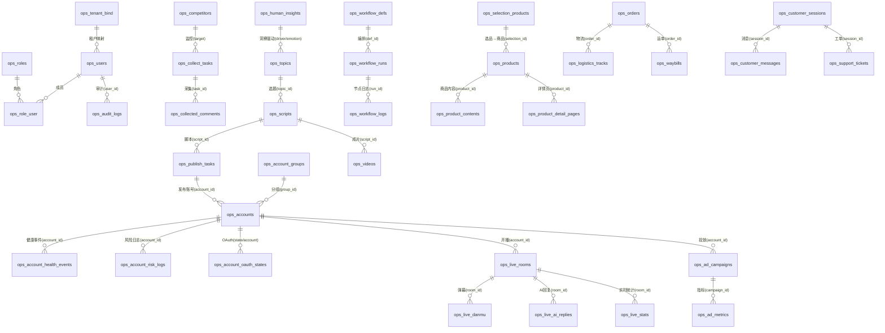

# 智享全链运营系统 · ER 图与索引设计

> 版本：v0.2.0 · 日期：2026-08-25 · 来源：`zhixiang-ops-backend/db/migrations/`（001~028）+ 各模块实体
> 迁移清单与执行状态见 `zhixiang-ops-workspace/docs/数据库变更清单.md`。

## 1. 表清单（按迁移分组）

| 迁移 | 表 | 归属域 |
|---|---|---|
| 001_base | `ops_users`（+ 会话/基础） | 鉴权 |
| 002_account | `ops_accounts`、`ops_account_health_events`、`ops_account_risk_logs` | B 账号矩阵 |
| 003_intel | `ops_competitors`、`ops_collected_comments`、`ops_collect_tasks`、`ops_hot_snapshots` | C 情报 |
| 004_analyze | `ops_analysis_tasks`、`ops_human_insights` | D 分析 |
| 005_topic_script | `ops_topics`、`ops_scripts`（含版本） | E/F |
| 006_publish | `ops_publish_tasks` | I 发布 |
| 007_workflow | `ops_workflow_defs`、`ops_workflow_runs`、`ops_workflow_logs` | L 工作流 |
| 008_recycle | `ops_feedback`、`ops_recycle_tasks`、`ops_driver_efficiency` | J 回收 |
| 009_n_role | `ops_roles`、`ops_role_user`、`ops_audit_logs` | N 团队/审计 |
| 010_t_selection | `ops_selection_products`、`ops_selection_lists` | T 选品 |
| 011_r_product | `ops_products`、`ops_product_contents`、`ops_product_detail_pages` | R 商品 |
| 012_k_live | `ops_live_rooms`、`ops_digital_humans`、`ops_live_danmu`、`ops_live_ai_replies`、`ops_live_stats` | K 直播 |
| 013_s_ad | `ops_ad_accounts`、`ops_ad_campaigns`、`ops_ad_metrics` | S 投流 |
| 014_u_private | `ops_fans_profiles`、`ops_private_groups` | U 私域 |
| 015_w_revenue | `ops_revenue_records`、`ops_reconciliations`、`ops_settlements` | W 收益 |
| 016_y_order | `ops_orders`、`ops_logistics_tracks`、`ops_waybills` | Y 订单 |
| 017_aa_cs | `ops_customer_sessions`、`ops_customer_messages`、`ops_support_tickets`、`ops_knowledge_base`、`ops_cs_settings` | AA 客服 |
| 018_dashboard | `ops_dashboards` | M 决策 |
| 019_materials | `ops_materials` | G 素材 |
| 020_videos | `ops_videos` | H 成片 |
| 021_sso_bind | `ops_tenant_bind`、`ops_role_bind` | 接入（SSO） |
| 022_sync_switch | `ops_sync_cursor`（+ 同步开关） | 接入（主数据同步） |
| 023_p0_missing | P0 阶段补缺表 | 各域 |
| 024_account_oauth | `ops_account_oauth_states` | B OAuth |
| 025_skill_provider_byo | 技能 Provider 自带密钥表 | Z 技能 |
| 026_system_configs | `ops_system_configs` | 配置中心 |
| 027_account_groups | `ops_account_groups`（`ops_accounts` 增 group_id/persona/health_score） | B 分组 |
| 028_intel_sources | 采集源配置表 | C 采集源 |

## 2. 核心 ER 关系（Mermaid）

## 3. 索引设计要点

- **通用**：所有表含 `tenant_id` + `created_at`/`updated_at`/`deleted_at`（BaseEntity），查询默认带租户过滤 → 组合索引以 `tenant_id` 为首列。
- **多租户强隔离索引**：业务表建 `(tenant_id, <业务键>)` 复合索引，例如
  - `ops_accounts`: `(tenant_id, platform, platform_account_id)` 唯一 → 重复账号 `ACCOUNT_DUPLICATE`
  - `ops_account_groups`: `(tenant_id, name)` 唯一 → 重名 `ACCOUNT_GROUP_DUPLICATE`
  - `ops_collected_comments`: `(tenant_id, source_ref, content_hash)` 唯一 → 采集去重
  - `ops_human_insights`: `(tenant_id, driver, emotion, title)` 唯一 → 洞察去重
  - `ops_publish_tasks` / `ops_orders`: `(tenant_id, status)`、`(tenant_id, created_at)` 分页/筛选
  - `ops_audit_logs`: `(tenant_id, ts)` 倒序审计查询
- **外键/引用**：跨系统主数据用 `ms_*_id` 外键列 + 本地自增 id；`ops_orders.ms_order_no` 唯一（幂等同步）。
- **软删**：删除一律 `deleted_at` 标记，不物理删（同步镜像 `sync_deleted`）。
- 全部索引以迁移脚本内 `CREATE INDEX`/`UNIQUE KEY` 为准；临时库验证幂等重跑通过。

## 4. 说明

- 本图为领域级视图，字段级明细以 `db/migrations/*.sql` 为唯一真相源。
- 迁移执行状态/日期维护在 `zhixiang-ops-workspace/docs/数据库变更清单.md`（历史行滞后于代码，已按最新迁移 028 补记计划）。
